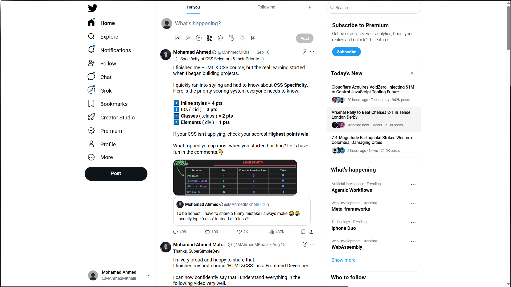
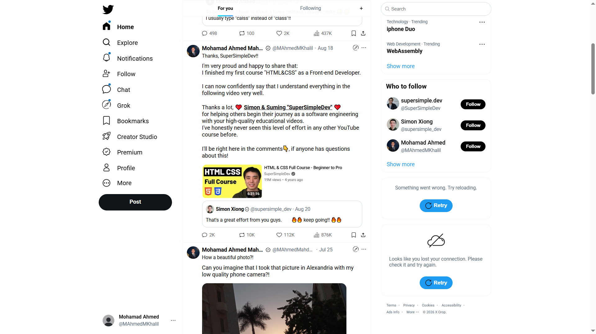
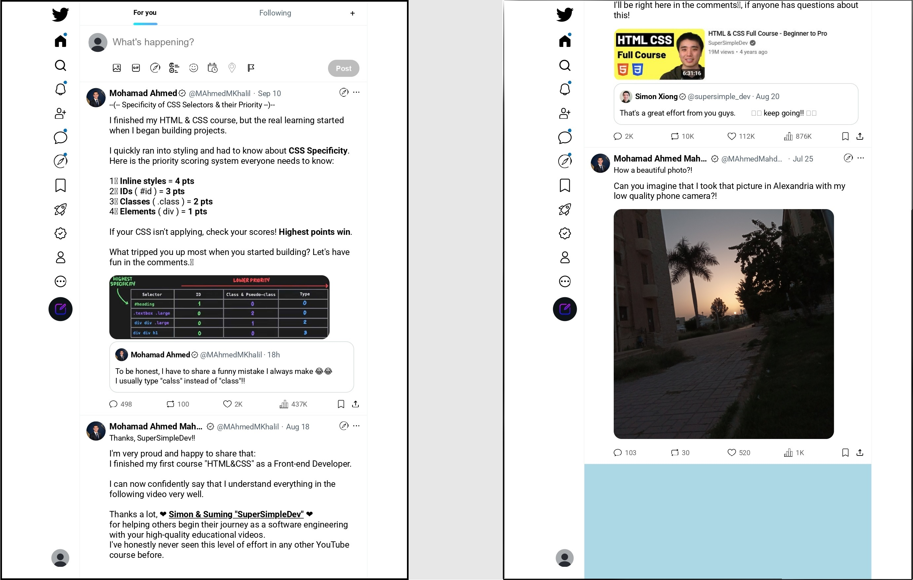
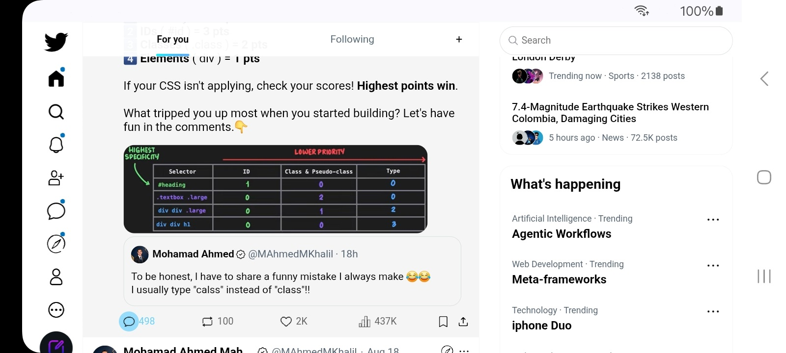
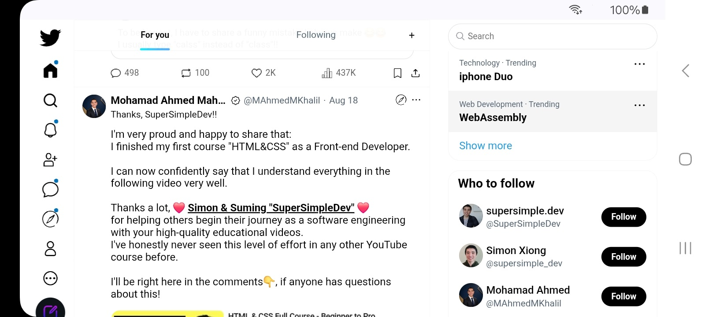
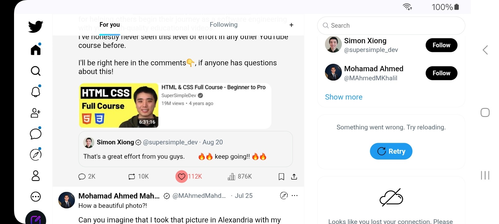

# Twitter/X Interface Clone
A responsive clone of the Twitter/X home page, built with **HTML and CSS only**.
I built it while learning front-end development.

[Live Demo](https://mahmdmkh.github.io/X..Twitter_-_Website/)
# Desktop view #1
- **Another views** at the **[end (↓)](https://github.com/MAhmdMKh/X..Twitter_-_Website/blob/main/README.md#Desktop-view-2)** of this file

## Features
- Fixed left sidebar with navigation links and a profile menu
- Sticky "For you" tabs and a post composer
- Feed with posts, images, comments, and reaction hover effects
- Profile hover cards (tooltips) built with CSS only
- Right sidebar: search, Premium box, Today's News, Trends, and Who to follow
- Responsive layout: the sidebar collapses to icons under 1150px, the right
  sidebar hides under 975px, and the feed adapts down to small phone widths

## What I practiced
HTML structure, the CSS box model, Flexbox, CSS Grid, positioning
(fixed, sticky, absolute, relative), hover effects and transitions,
media queries, and Chrome DevTools.

## Tech
HTML5 · CSS3 (no JavaScript)

## Known limitations and next steps
- This is a static UI: buttons and menus are not fully interactive yet.
  I'm learning JavaScript to add this.
- Some values are fixed in `px`. I plan to move to `rem` and fluid units.

## Credits
Built while following the course
[HTML & CSS Full Course - Beginner to Pro](https://www.youtube.com/watch?v=G3e-cpL7ofc)
by SuperSimpleDev. Thank you for the great free course!

# Desktop view #2

# Tablet view #1 #2

# Mobile view #1

# Mobile view #2

# Mobile view #3

